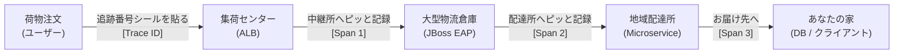
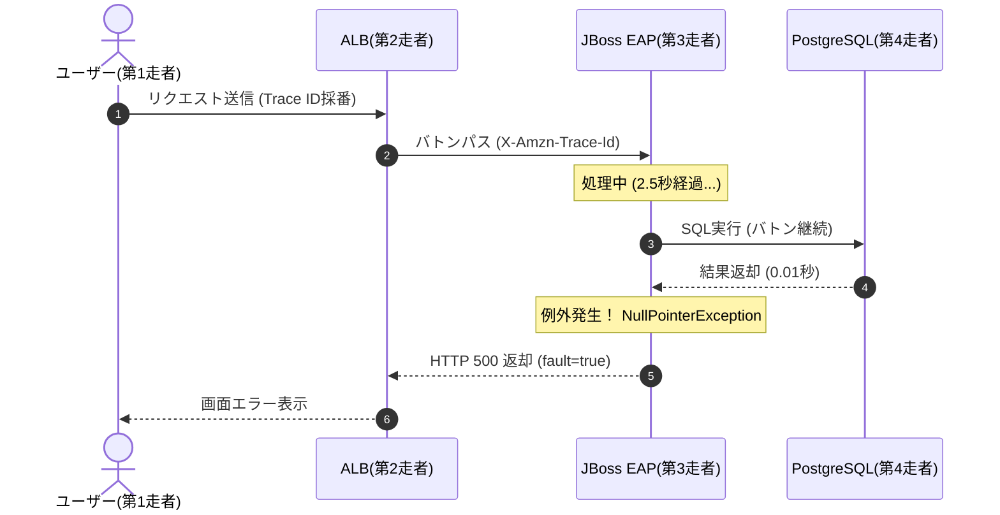
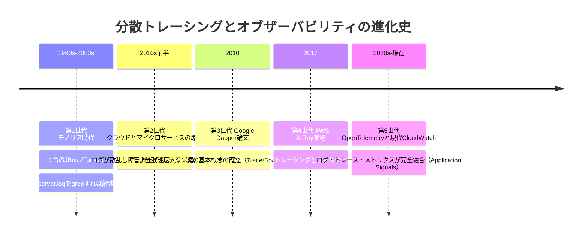
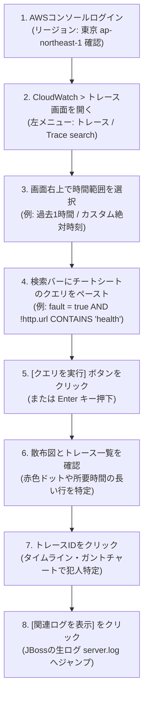

# AWS CloudWatch トレースクエリ 完全制覇チートシート＆詳細技術リファレンス
**〜 コピペで即実行できる実践クエリ集・動作原理・誕生の歴史から小学生でもわかる解説まで 〜**

---

## 目次

1. [はじめに：本ドキュメントの目的と構成](#1-はじめに本ドキュメントの目的と構成)
2. [小学生にもわかる！ 分散トレーシングの超直感イメージ](#2-小学生にもわかる-分散トレーシングの超直感イメージ)
   - [たとえ話①：宅配便の荷物追跡バーコード](#たとえ話①宅配便の荷物追跡バーコード)
   - [たとえ話②：運動会の全員リレーと先生のストップウォッチ](#たとえ話②運動会の全員リレーと先生のストップウォッチ)
   - [たとえ話③：大病院の総合カルテとスタンプラリー](#たとえ話③大病院の総合カルテとスタンプラリー)
3. [分散トレーシング登場の歴史と背景：なぜ必要になったのか？](#3-分散トレーシング登場の歴史と背景なぜ必要になったのか)
   - [第1世代：モノリス時代（1990s〜2000s）と `grep` の日々](#第1世代モノリス時代1990s2000sと-grep-の日々)
   - [第2世代：マイクロサービスの爆発と「暗黒の障害調査」（2010s前半）](#第2世代マイクロサービスの爆発と暗黒の障害調査2010s前半)
   - [第3世代：Google Dapper論文の衝撃（2010年）](#第3世代google-dapper論文の衝撃2010年)
   - [第4世代：AWS X-Rayの誕生（2017年）](#第4世代aws-x-rayの誕生2017年)
   - [第5世代：OpenTelemetryへの大統合と現代のCloudWatch（2020s〜現在）](#第5世代opentelemetryへの大統合と現代のcloudwatch2020s現在)
4. [分散トレーシングの内部アーキテクチャと動作原理](#4-分散トレーシングの内部アーキテクチャと動作原理)
   - [コンテキスト伝播（Context Propagation）の仕組み](#コンテキスト伝播context-propagationの仕組み)
   - [サンプリング機構（Sampling Rate）：なぜ全件記録しないのか？](#サンプリング機構sampling-rateなぜ全件記録しないのか)
   - [セグメント・サブセグメント・スパンの階層構造（DAG）](#セグメントサブセグメントスパンの階層構造dag)
   - [アノテーション（検索可）とメタデータ（検索不可）の決定的な違い](#アノテーション検索可とメタデータ検索不可の決定的な違い)
   - [クエリエンジンのスキャン機構と時間パーティション](#クエリエンジンのスキャン機構と時間パーティション)
5. [【即戦力】CloudWatch トレースクエリ コピペ用チートシート](#5-即戦力cloudwatch-トレースクエリ-コピペ用チートシート)
   - [① エラーのフィルタ（5xx, 4xx, 429, 非正常）](#51-エラーのフィルタ5xx-4xx-429-非正常)
   - [② 時間範囲・レスポンス時間のフィルタ（遅延・スロークエリ）](#52-時間範囲レスポンス時間のフィルタ遅延スロークエリ)
   - [③ サービス・エッジ・ロググループ相関フィルタ](#53-サービスエッジロググループ相関フィルタ)
   - [④ JBoss EAP エラーコード フィルタ（WFLY, IJ, UT, ARJUNA）](#54-jboss-eap-エラーコード-フィルタwfly-ij-ut-arjuna)
   - [⑤ Java 例外メッセージ フィルタ（NPE, OOM, SQL, Timeout）](#55-java-例外メッセージ-フィルタnpe-oom-sql-timeout)
   - [⑥ 文字列を指定しての除外フィルタ（ヘルスチェック・ノイズ排除）](#56-文字列を指定しての除外フィルタヘルスチェックノイズ排除)
   - [⑦ 実務の複合・即戦力トラブルシューティング クエリ](#57-実務の複合即戦力トラブルシューティング-クエリ)
6. [CloudWatch Logs Insights ＆ トランザクション検索（`/aws/spans`）実践クエリ](#6-cloudwatch-logs-insights-＆-トランザクション検索awsspans実践クエリ)
7. [JBoss EAP ＆ Java 本番障害の逆引きトラブルシューティング](#7-jboss-eap-＆-java-本番障害の逆引きトラブルシューティング)
8. [AWSマネジメントコンソール 操作ステップバイステップ実行マニュアル](#8-awsマネジメントコンソール-操作ステップバイステップ実行マニュアル)
9. [まとめとベストプラクティス](#9-まとめとベストプラクティス)

---

## 1. はじめに：本ドキュメントの目的と構成

AWSでWebシステムや基幹システムを運用していると、以下のような緊急トラブルに必ず直面します。

- 「画面に『システムエラーが発生しました』と表示されたが、どのサーバーのどのプログラムで落ちたのかわからない」
- 「画面の読み込みに10秒以上かかってタイムアウトするが、Webサーバー、APサーバー（JBoss EAP）、DBのどこが詰まっているのか特定できない」
- 「ALBの死活監視ログや監視ツールの定期アクセスが毎秒何百件も流れてきて、本物のユーザー障害ログが埋もれて見つからない」

これらを一瞬で解決するのが、**Amazon CloudWatch の分散トレーシング機能（CloudWatch Traces / AWS X-Ray / Transaction Search）** です。

本書は、AWSマネジメントコンソールの「トレース」検索画面、および「Logs Insights」画面に**コピー＆ペーストして「クエリを実行」ボタンを押すだけで、即座に障害原因を特定できる実践クエリ集**です。
さらに、新任エンジニアや小学生でも直感的に理解できるよう、動作原理・たとえ話・歴史的背景を交えて極めて明快に解説しています。

---

## 2. 小学生にもわかる！ 分散トレーシングの超直感イメージ

### たとえ話①：宅配便の荷物追跡バーコード

あなたがAmazonやネット通販でおもちゃを注文したとします。



- **Trace ID（トレースID）**：荷物の箱にペタッと貼られた**「お問合せ伝票番号（バーコード）」**です。
- **Span（スパン）**：荷物が中継所を通るたびに、配達員さんが専用端末で**「ピッ！」と読み取った通過記録**です。

もし荷物が届かなかったり、届くのが2日も遅れたりしたらどうしますか？
何万個もある段ボール箱を1個ずつ手作業で探す人はいません。
伝票番号をスマホに入力すれば、**「昨日の夜9時、第3中継倉庫（JBoss EAP）で荷物が止まったままになっている！」** と一瞬でわかります。
これが**トレース検索**です。

---

### たとえ話②：運動会の全員リレーと先生のストップウォッチ

クラス対抗の全員リレーを思い出してください。

- 第1走者：Webブラウザ画面（ボタンを押す）
- 第2走者：フロントエンドALB（荷物を受け渡す）
- 第3走者：JBoss EAPサーバー（注文データを作成する）
- 第4走者：データベース（注文を保存する）

走者同士が渡す**「バトン」**の中に、タイム計測用の小さなICチップが入っています（これを専門用語で**HTTPヘッダーのコンテキスト伝播**と呼びます）。



先生（CloudWatch）はトラックの外でストップウォッチを持って立っています。
ゴールタイムが異常に遅かったり、途中で誰かが転んだとき、先生の記録シートを見れば：
- 「誰が何秒走ったか（レイテンシー）」
- 「誰がバトンを落としたのか（エラー発生源）」
が一目瞭然になります。

---

### たとえ話③：大病院の総合カルテとスタンプラリー

大きな大学病院に行くと、受付で**「総合カルテ（Trace ID）」**をファイルに入れて渡されます。

1. 内科の診察室へ行く
2. レントゲン室へ行く
3. 血液検査室へ行く
4. お薬をもらう（薬局）

お医者さんや検査技師さんは、カルテに「血圧：正常」「白血球：やや高い」といった**メモ（アノテーション）**を書き込み、受領印を押します。
後から院長先生がコンピュータで「カルテメモに『WFLYCTL0013』または『NullPointerException』と書かれた患者さん全員を画面に出して！」と検索すると、該当するカルテが一発で机の上に並びます。

---

## 3. 分散トレーシング登場の歴史と背景：なぜ必要になったのか？

なぜこのような「トレースクエリ」という技術が生まれ、全AWSエンジニアにとって必須となったのでしょうか？ その劇的な歴史を紐解きます。



### 第1世代：モノリス時代（1990s〜2000s）と `grep` の日々
かつてのシステムは、巨大な1台の物理サーバーの中に、OS、Webサーバー、JBoss EAP（またはWebLogic, WebSphere）、データベースが同居するか、せいぜい2〜3台に分かれているだけでした（**モノリシックアーキテクチャ**）。

この時代の障害調査は極めてシンプルでした。
SSHでサーバーにログインし、黒い画面で以下のコマンドを叩くだけで済んだのです。
```bash
grep "ERROR" /opt/jboss-eap/standalone/log/server.log
```
1つのリクエストは同一マシンの1つのスレッドの中で上から下まで直線的に実行されるため、ログファイルの上から下へ読んでいけば何が起きたか誰でも理解できました。

### 第2世代：マイクロサービスの爆発と「暗黒の障害調査」（2010s前半）
2010年代に入り、AWSなどのクラウドが急拡大し、Dockerコンテナやマイクロサービスアーキテクチャが主流になりました。
1つのシステムが、数十〜数百の独立した小さなサービス（認証API、商品API、決済API、配送API...）に分割されたのです。

ここで世界中のエンジニアが**未曾有の悪夢（暗黒時代）**に直面しました。
ユーザーが「注文ボタン」を1回ポチッと押しただけで、裏側で20個以上のコンテナやLambda関数が網の目のように通信し合います。
そして画面に「エラー」が出たとき：
- **20個あるサーバーのうち、どこでエラーが起きたのか誰もわからない！**
- 各サーバーにバラバラに出力された何百万行ものログの中から、**「どれとどれが同じ注文処理のログなのか」を紐付ける方法が存在しない！**
- 障害のたびに何十人ものエンジニアが集まり、サーバーごとにログの時刻をミリ秒単位で見比べながら「この10時15分32秒のログと、そっちの33秒のログは同じリクエストかな...？」と探偵ごっこをして徹夜する地獄が発生しました。

### 第3世代：Google Dapper論文の衝撃（2010年）
このカオスに終止符を打ったのが、Googleが2010年に発表した伝説的な論文**『Dapper, a Large-Scale Distributed Systems Tracing Infrastructure』**です。
Googleの天才エンジニアたちは以下を提唱しました。

> 「最初のリクエストが入ってきた時に一意な『Trace ID』を発行し、すべてのHTTP/RPC通信のヘッダーにバトンとして乗せてリレーさせよう。各サーバーはそのIDをキーにして自分の区間の処理記録（Span）を外付けの蓄積基盤に送ればいい。」

このシンプルな着想により、世界中の分散システムが一本の線（トレース）として可視化できるようになりました。TwitterのZipkinやUberのJaegerなど、オープンソースのトレーシング基盤が次々と誕生しました。

### 第4世代：AWS X-Rayの誕生（2017年）
AWSは2016年のre:Inventで発表、2017年に**AWS X-Ray**を正式リリース（GA）しました。
AWSマネージドサービスであるALB、API Gateway、ECS、Lambdaなどと最初から統合されており、コードにエージェントを入れるだけで自動的にトレースを収集できるようになりました。
ここで実装されたのが、本書の主役である**「フィルター式（Filter Expressions）」**です。
```text
service("jboss-eap") { fault = true } AND responsetime > 2.0
```
人間が英語を読むような直感的な構文で、数億件のトランザクションから瞬時に異常を炙り出せるようになりました。

### 第5世代：OpenTelemetryへの大統合と現代のCloudWatch（2020s〜現在）
2019年、業界標準化団体CNCFのもとで「OpenTracing」と「OpenCensus」が統合され、**OpenTelemetry（OTel）**が誕生しました。
AWSもこれに全面準拠し、「AWS Distro for OpenTelemetry（ADOT）」を公式提供。
さらに最新のCloudWatchでは、**「CloudWatch Transaction Search」**や**「CloudWatch Application Signals」**が登場。
トレースデータは標準で `/aws/spans` ロググループに格納され、ログ（Logs）とトレース（Traces）とメトリクス（Metrics）の境界線が完全に消え去り、1クリックで双方向に行き来できる**現代のオブザーバビリティ（可観測性）**が完成しました。

---

## 4. 分散トレーシングの内部アーキテクチャと動作原理

CloudWatch トレースクエリがなぜあのように爆速で検索できるのか、内部のメカニズムを解説します。

```mermaid
flowchart TD
    subgraph Client["クライアント層"]
        Browser["ブラウザ / モバイルアプリ"]
    end

    subgraph AWS_Ingress["AWS 境界層"]
        ALB["Application Load Balancer\n・Trace IDを新規採番\n・X-Amzn-Trace-Id ヘッダー付与"]
    end

    subgraph App_Layer["アプリケーション層 (ECS / EC2)"]
        JBoss["JBoss EAP 7/8 (Java JVM)\n・OTel / X-Ray SDKでヘッダー抽出\n・Subsegment (SQL, HTTP) 計測\n・Annotation (WFLYコード, NPE) 付与"]
    end

    subgraph Backend["バックエンド層"]
        RDS[("Amazon RDS (PostgreSQL/Oracle)\nSQL処理・コネクション")]
    end

    subgraph CloudWatch_Plane["CloudWatch コントロールプレーン"]
        XRayDaemon["AWS X-Ray デーモン / OTel Collector\n(UDP 2000番で非同期受信)"]
        TraceStorage["CloudWatch Traces ストレージ\n(時間パーティション / インデックス化)"]
        SpansLog["CloudWatch Logs: /aws/spans"]
        Console["マネジメントコンソール\n・トレース検索バー\n・Logs Insights エンジン"]
    end

    Browser -->|"HTTP Request"| ALB
    ALB -->|"X-Amzn-Trace-Id 注入"| JBoss
    JBoss -->|"JDBC / SQL"| RDS
    RDS -->> JBoss
    JBoss -->> ALB
    ALB -->> Browser

    ALB -.->|"スパン送信"| XRayDaemon
    JBoss -.->|"非同期UDPスパン送信"| XRayDaemon
    XRayDaemon --> TraceStorage
    XRayDaemon --> SpansLog
    Console -->|"クエリ実行 (Filter Expression)"| TraceStorage
    Console -->|"Logs Insights クエリ"| SpansLog
```

### コンテキスト伝播（Context Propagation）の仕組み
リクエストがネットワークを越えていくとき、通信ヘッダーにメタデータを含めて引き継ぐ仕組みを**コンテキスト伝播**と呼びます。

#### AWS独自形式：`X-Amzn-Trace-Id`
```http
X-Amzn-Trace-Id: Root=1-670dcba0-123456789abcdef012345678;Parent=53995cbe31412827;Sampled=1
```
- `Root`: トランザクション全体を一意に識別する**Trace ID**（タイムスタンプ＋ランダム値）。
- `Parent`: 直前の呼び出し元ノードの**Span ID**。
- `Sampled`: `1`なら詳細データを記録、`0`ならサンプリング対象外（計測スキップ）。

#### 世界標準規格：W3C TraceContext（OpenTelemetry標準）
```http
traceparent: 00-4bf92f3577b34da6a3ce929d0e0e4736-00f067aa0ba902b7-01
```
`バージョン(00)` - `Trace ID(32桁hex)` - `Parent Span ID(16桁hex)` - `Trace Flags(01: Sampled)`

### サンプリング機構（Sampling Rate）：なぜ全件記録しないのか？
1秒間に10万リクエストが押し寄せる巨大ECサイトで、10万件すべてのトレース詳細を記録するとどうなるでしょうか？
トレースの送信と保存だけで莫大なネットワーク帯域・ストレージコスト・CPUオーバーヘッドが発生してしまいます。

そこでCloudWatch X-Rayは**インテリジェント・サンプリング**を採用しています。
- **リザーバー（Reservoir）**：毎秒最初の「1リクエスト」は無条件で必ずサンプリング（最低限の稼働証明）。
- **固定レート（Fixed Rate）**：それを超えた分は、例えば「5%」だけを均等にランダムサンプリング。
- **エラー優先サンプリング**：途中で例外やHTTP 5xxが発生したリクエストは、サンプリング枠を越えて優先的に完全保存する仕組み（Adaptive Sampling）。

### セグメント・サブセグメント・スパンの階層構造（DAG）
- **Segment（セグメント）**：1つの計算リソース（例: JBoss EAPサーバー）が処理した全体の時間と情報。
- **Subsegment（サブセグメント）**：セグメントの内部で実行された下位タスク。例えば「PostgreSQLへのSELECTクエリ実行」「外部決済APIへのHTTP POST」「S3バケットへのファイルアップロード」。
これらが親子関係で結ばれ、**有向非巡回グラフ（DAG: Directed Acyclic Graph）**として木構造のタイムラインを形成します。

### アノテーション（検索可）とメタデータ（検索不可）の決定的な違い
ここが**CloudWatchトレースクエリを書く上で最も重要な技術的境界線**です！

| 項目 | Annotation（アノテーション） | Metadata（メタデータ） |
| :--- | :--- | :--- |
| **用途** | **検索用インデックス（クエリ対象）** | 詳細確認用データ（画面閲覧用） |
| **クエリ検索** | **可能**（`annotation.key = "val"`） | **不可**（クエリ対象外） |
| **データ型** | 文字列、数値、真偽値（最大50個まで） | 任意の巨大なJSONオブジェクト |
| **例** | `errorCode = "WFLYCTL0013"`, `userId = 101` | リクエストBody全体のJSON、全環境変数 |

> [!IMPORTANT]
> JBoss EAPのエラーコードやJavaの例外名をトレース検索バーからクエリで引き抜くためには、X-Ray SDKまたはOpenTelemetryのエージェント設定で、それらの値を**「Annotation（またはSpan Attribute）」**としてセットしておく必要があります。

### クエリエンジンのスキャン機構と時間パーティション
CloudWatchのバックエンドストレージは、タイムスタンプをパーティションキーとしてデータを物理的に分割格納しています。
そのため、**「過去15分」や「過去1時間」に時間範囲を絞ると、走査（スキャン）対象のストレージブロックが極小化され、クエリが数秒以内で完了**します。逆に「過去30日間」などを選ぶと全ブロックをスキャンするため時間がかかります。

---

## 5. 【即戦力】CloudWatch トレースクエリ コピペ用チートシート

AWSマネジメントコンソールの「トレース」検索バーに、そのまま貼り付けて実行できる実践クエリ集です。

### 5.1 エラーのフィルタ（5xx, 4xx, 429, 非正常）

#### ① サーバー側障害（HTTP 5xx / 未処理例外）のみを抽出
```text
fault = true
```
- **動作**：HTTPステータス500, 502, 503, 504や、Javaの未キャッチ例外でクラッシュしたトレースのみを抽出します。
- **実務での用途**：システム障害アラート発生時、最初に叩く最重要クエリです。

#### ② クライアントエラー（HTTP 4xx）を抽出
```text
error = true
```
- **動作**：400 Bad Request, 401 Unauthorized, 403 Forbidden, 404 Not Foundなどを抽出。
- **実務での用途**：ユーザーの入力不正、トークン期限切れ、権限エラーの調査に使用。

#### ③ スロットリング（レート制限 / HTTP 429）を抽出
```text
throttle = true
```
- **動作**：API GatewayやDynamoDB、自社APIの同時実行数制限に引っかかったリクエストを抽出。

#### ④ 全エラー統合（4xx または 5xx）
```text
error = true OR fault = true
```

#### ⑤ 厳密なHTTPステータスコード指定（500 Internal Server Error）
```text
http.status = 500
```

#### ⑥ ゲートウェイ障害（502〜504 範囲指定）
```text
http.status BETWEEN 502 AND 504
```
- **動作**：ALBやNginx、API Gatewayで発生した接続断・タイムアウト（502 Bad Gateway, 503 Service Unavailable, 504 Gateway Timeout）を抽出。

#### ⑦ 正常終了しなかった全リクエスト（非ok）
```text
!ok
```

---

### 5.2 時間範囲・レスポンス時間のフィルタ（遅延・スロークエリ）

> [!NOTE]
> `responsetime` の単位は**秒（実数値）**です（例: 2秒は `2.0`、500ミリ秒は `0.5`）。

#### ① 2秒以上かかった遅延リクエストの抽出
```text
responsetime >= 2.0
```

#### ② 5秒以上の深刻なボトルネック・スロークエリ抽出
```text
responsetime > 5.0
```

#### ③ レスポンスタイムの範囲指定（1秒〜3秒）
```text
responsetime BETWEEN 1.0 AND 3.0
```
- **実務での用途**：タイムアウト値（例: 3秒）寸前でかろうじて返ってきている「隠れた高負荷リクエスト」を早期発見。

#### ④ 3秒以上遅延し、かつ最終的に5xxエラーとなった最悪パターンの特定
```text
responsetime >= 3.0 AND fault = true
```

---

### 5.3 サービス・エッジ・ロググループ相関フィルタ

#### ① JBoss EAPサービスノードを通過した全トレース
```text
service("jboss-eap-app")
```
※ `"jboss-eap-app"` 部分はご自身のX-Rayサービス名・ECSタスク名に置き換えてください。

#### ② JBoss EAP自身が原因で発生した5xx障害に限定
```text
service("jboss-eap-app") { fault = true }
```
- **解説**：中括弧 `{ }` で囲むと、「そのサービスノードの区間内でエラーが発生したか」をスコープ評価します。後続の外部APIエラーがJBossに波及したケースを除外し、JBoss自身の過失のみを特定できます。

#### ③ ALBからJBoss EAPへの通信パス（エッジ）を指定
```text
edge("Frontend-ALB", "jboss-eap-app") { fault = true }
```

#### ④ JBoss EAPからデータベース（PostgreSQL/Oracle）への通信エッジ障害
```text
edge("jboss-eap-app", "PostgreSQL-RDS") { fault = true }
```

---

### 5.4 JBoss EAP エラーコード フィルタ（WFLY, IJ, UT, ARJUNA）

JBoss EAP（WildFly）は、エラーメッセージの先頭に一意の**サブシステム記号＋番号**を出力します。これらがアノテーション（Annotation）として記録されている場合の抽出クエリです。

#### ① WildFly 管理操作失敗コード（WFLYCTL0013）
```text
annotation.errorCode = "WFLYCTL0013"
```

#### ② IronJacamar DBコネクションプール枯渇（IJ000453）
```text
annotation.errorCode = "IJ000453"
```
- **解説**：JBoss EAPのJCAコネクションプールから接続を取得できず、待機上限に達した致命的障害。

#### ③ Undertow Webリクエスト処理例外（UT005023）
```text
annotation.errorCode = "UT005023"
```

#### ④ WFLYで始まるすべてのJBoss管理エラーコード（前方一致）
```text
annotation.errorCode STARTSWITH "WFLY"
```

#### ⑤ データソース関連サブシステムのトレース
```text
annotation.subsystem = "datasources"
```

---

### 5.5 Java 例外メッセージ フィルタ（NPE, OOM, SQL, Timeout）

#### ① NullPointerException（ヌルポインター例外・ぬるぽ）
```text
annotation.exception CONTAINS "NullPointerException"
```
- **解説**：Java開発で最も頻発するオブジェクト参照バグを部分一致（CONTAINS）で抽出。

#### ② データベースSQL例外（SQLException）
```text
annotation.exception CONTAINS "SQLException"
```

#### ③ メモリ枯渇・ヒープ枯渇（OutOfMemoryError）
```text
annotation.exception CONTAINS "OutOfMemoryError"
```
- **実務での用途**：JVMが死ぬ直前に処理していたリクエスト（OOMを引き起こした引き金トランザクション）を特定。

#### ④ タイムアウト例外（TimeoutException / SocketTimeoutException）
```text
annotation.exception CONTAINS "TimeoutException"
```

#### ⑤ DB一意制約違反（ConstraintViolationException）
```text
annotation.exception CONTAINS "ConstraintViolationException"
```

---

### 5.6 文字列を指定しての除外フィルタ（ヘルスチェック・ノイズ排除）

実務では、ALBやKubernetes、監視ツールが数秒おきに投げる**「ヘルスチェック」**がログやトレースの90%以上を占め、本物の障害を見落とす最大の原因になります。以下の除外構文で完全にノイズを一掃します。

#### ① ヘルスチェックURLを完全に除外
```text
!http.url CONTAINS "health"
```
- **解説**：`!` 記号（または `NOT`）により、URLに `health`（例: `/health`, `/healthcheck`, `/actuator/health`）を含むものをすべて排除します。

#### ② ALBヘルスチェッカーのUser-Agentを除外
```text
NOT http.user_agent CONTAINS "ELB-HealthChecker"
```

#### ③ CORSプリフライト（OPTIONSメソッド）を除外
```text
http.method != "OPTIONS"
```

#### ④ メトリクス収集エンドポイントを除外
```text
!http.url CONTAINS "metrics" AND !http.url CONTAINS "prometheus"
```

---

### 5.7 実務の複合・即戦力トラブルシューティング クエリ

現場でそのまま使える、条件を組み合わせた最強の障害調査クエリです。

#### 🌟 鉄板①：ヘルスチェックを完全除外し、本番ユーザー向けリクエストの障害のみを抽出
```text
fault = true AND !http.url CONTAINS "health" AND NOT http.user_agent CONTAINS "ELB"
```

#### 🌟 鉄板②：JBoss EAPで発生した2秒以上の遅延かつエラーとなったリクエスト（ヘルスチェック除外）
```text
service("jboss-eap-app") { fault = true } AND responsetime >= 2.0 AND !http.url CONTAINS "health"
```

#### 🌟 鉄板③：404（存在しないURL）を除外し、本当のクライアント不具合（400や403）のみを抽出
```text
error = true AND http.status != 404
```

#### 🌟 鉄板④：特定の特定ユーザーIDで発生した5xxサーバー障害を追跡
```text
user = "user-98765" AND fault = true
```

---

## 6. CloudWatch Logs Insights ＆ トランザクション検索（`/aws/spans`）実践クエリ

CloudWatchコンソールの**「Logs Insights」**画面で使用するクエリです。
JBoss EAPのロググループ（例: `/aws/ecs/jboss-eap`）や、スパンロググループ（`/aws/spans`）を選択して貼り付けます。

### ① JBossログからエラーおよびWFLYコードを抽出し、死活監視を除外
```logs-insights
fields @timestamp, @logStream, @message
| filter @message like /ERROR/ or @message like /WFLY/
| filter @message not like /healthcheck/
| filter @message not like /ELB-HealthChecker/
| sort @timestamp desc
| limit 100
```

### ② JBoss サブシステムエラーコード別の発生件数ランキング
```logs-insights
fields @timestamp, @message
| parse @message /(?<jbossCode>[A-Z]{2,7}[0-9]{4,6})/
| filter ispresent(jbossCode)
| stats count(*) as errorCount by jbossCode
| sort errorCount desc
| limit 20
```

### ③ Java NullPointerException と根本原因（Caused by:）の抽出
```logs-insights
fields @timestamp, @message
| filter @message like /NullPointerException/ or @message like /Caused by:/
| sort @timestamp desc
| limit 50
```

### ④ IronJacamar DBコネクションプール枯渇ログの抽出
```logs-insights
fields @timestamp, @message
| filter @message like /IJ000453/ or @message like /IJ000655/
| sort @timestamp desc
| limit 50
```

### ⑤ トランザクション検索（`/aws/spans`）：エラーまたは2秒以上遅延したスパン一覧
```logs-insights
fields @timestamp, traceId, serviceName, name, duration, status.code
| filter status.code = "ERROR" or duration > 2000
| sort duration desc
| limit 50
```

### ⑥ 特定のTrace IDに紐づく複数サーバーのログを時系列で串刺し復元
```logs-insights
fields @timestamp, @log, @message
| filter @message like /1-670dcba0-123456789abcdef012345678/
| sort @timestamp asc
```
※ トレース画面で見つけた問題のTrace IDに置き換えて実行してください。

---

## 7. JBoss EAP ＆ Java 本番障害の逆引きトラブルシューティング

| カテゴリ | エラーコード / 例外 | 発生原因と症状 | 即実行クエリ（コンソール用） | 根本対策・復旧手順 |
| :--- | :--- | :--- | :--- | :--- |
| **DBプール枯渇** | `IJ000453`<br>(IronJacamar) | `Unable to get managed connection`<br>DB接続プールが上限に達し、待機がタイムアウト。 | `annotation.errorCode = "IJ000453"`<br>または Logs Insights:<br>`filter @message like /IJ000453/` | 1. `max-pool-size` の引き上げ<br>2. コネクション解放漏れ（リーク）の修正<br>3. `leak-detection-threshold` の有効化 |
| **待機タイムアウト** | `IJ000655`<br>(IronJacamar) | `No managed connections available within blocking timeout` | `annotation.errorCode = "IJ000655"` | スロークエリの特定とDBインデックス追加。 |
| **デプロイ失敗** | `WFLYSRV0026`<br>(Server) | `Failed to start service`<br>JBoss起動時やデプロイ時に依存初期化失敗。 | `annotation.errorCode = "WFLYSRV0026"` | 依存JARの競合解消、データソース疎通確認。 |
| **Web通信エラー** | `UT005023`<br>(Undertow) | `Exception handling request`<br>Undertowがリクエスト処理中に例外発生。 | `annotation.errorCode = "UT005023"` | 直後のスタックトレースから業務バグを改修。 |
| **トランザクション** | `ARJUNA016051`<br>(Narayana) | `Thread is already associated with a transaction`<br>JTAトランザクションの二重割り当て。 | `annotation.errorCode = "ARJUNA016051"` | EJBトランザクション属性（`REQUIRES_NEW`等）の見直し。 |
| **Javaバグ** | `NullPointerException`<br>(java.lang) | null参照のオブジェクトに対してメソッド呼出。 | `annotation.exception CONTAINS "NullPointerException"` | 入力パラメータのバリデーション、Optionalの適用。 |
| **メモリ枯渇** | `OutOfMemoryError`<br>(java.lang) | JVMヒープ領域またはメタスペース枯渇。 | `annotation.exception CONTAINS "OutOfMemoryError"` | ECSタスク再起動、ヒープダンプ取得（MAT解析）、`-Xmx` 拡張。 |

---

## 8. AWSマネジメントコンソール 操作ステップバイステップ実行マニュアル

初心者でも絶対に迷わない、コンソール画面での操作手順です。



### 各ステップの詳細手順

1. **リージョンの確認**
   - 画面右上のリージョンが、システムが動いているリージョン（例: **アジアパシフィック (東京) `ap-northeast-1`**）になっていることを確認します。別のリージョンだとデータが0件になります。
2. **トレース画面の表示**
   - 上部検索バーに `CloudWatch` と入力して開き、左側メニューの **「X-Ray トレース」** または **「アプリケーションの監視」>「トレース」** をクリックします。
3. **時間範囲の指定**
   - 画面右上のタイムピッカー（時計アイコン）をクリックし、**障害が発生した時刻に合わせて「過去1時間」や「カスタム（開始〜終了時刻）」を指定**します。広すぎる範囲を指定すると検索に時間がかかるため、必要最小限に絞るのがコツです。
4. **クエリの貼り付け**
   - 画面上部にある横長の検索入力欄（「フィルター式の入力」プレースホルダー）をクリックし、本チートシートのクエリを `Ctrl + V`（Macは `Cmd + V`）で貼り付けます。
5. **クエリの実行**
   - 検索バーの右端にある青い **「実行」**（または **「トレースの検索」**）ボタンをクリックします。キーボードの **`Enter` キー** を押すだけでも即座に実行されます。
6. **結果の見方**
   - **散布図（グラフ）**：横軸が時刻、縦軸がレスポンス時間です。**緑色＝正常、黄色＝4xxエラー、赤色＝5xx障害**です。赤色ドットが密集している箇所があれば、そこが障害発生ポイントです。
   - **トレースリスト（一覧表）**：「レスポンス時間」のヘッダーをクリックすると遅延順にソートできます。
7. **詳細タイムライン（ガントチャート）の分析**
   - 最も怪しい行の **「Trace ID」リンク** をクリックします。
   - ALB → JBoss EAP → PostgreSQL とリクエストが流れるガントチャートが表示されます。**「どのバーが最も長く伸びているか（ボトルネック）」**、**「どのバーに赤いエラーマークがついているか」** を見れば、1秒で原因箇所が特定できます。
8. **関連ログへのジャンプ**
   - 画面右側の **「ログ (Logs)」タブ**、またはスパン右側の **「関連ログの表示」** をクリックすると、そのリクエストの処理中にJBoss EAPが出力した `server.log` の行が自動的にフィルタされて表示されます。

---

## 9. まとめとベストプラクティス

1. **基本は「エラー」＋「ノイズ除外」から始める**
   本番で何か起きたら、まずは以下のクエリを実行してください。
   ```text
   fault = true AND !http.url CONTAINS "health"
   ```
   これでヘルスチェックの嵐をかき分け、真のサーバー障害だけが手元に残ります。
2. **遅延調査は「2秒以上」で切る**
   ```text
   responsetime >= 2.0
   ```
   ユーザー体験を損ねているスロークエリや外部API遅延が浮き彫りになります。
3. **時間枠を絞る**
   クエリの実行速度とコストを最小化するため、必ずコンソールのタイムピッカーで発生時間帯を絞り込んでから実行してください。

---
*Created for Production AWS Engineers & Operations Teams. Powered by Amazon CloudWatch & OpenTelemetry.*
